<picture>
  <source media="(max-width: 600px) and (prefers-color-scheme: dark)" srcset="assets/profile/intro-mobile-dark.svg">
  <source media="(max-width: 600px)" srcset="assets/profile/intro-mobile-light.svg">
  <source media="(prefers-color-scheme: dark)" srcset="assets/profile/intro-dark.svg">
  
</picture>

Some ideas need a script. Others need a soldering iron. I enjoy both—and figuring out how the pieces fit together.

## Pick something to explore

<a href="https://github.com/chain567/Haptic-Navigation-Software"><picture><source media="(prefers-color-scheme: dark)" srcset="assets/profile/vibeguide-dark.svg"></picture></a>
<a href="https://github.com/chain567/visio-batch-image"><picture><source media="(prefers-color-scheme: dark)" srcset="assets/profile/visio-dark.svg"></picture></a>

<a href="https://github.com/chain567/nyu-av-sample-app"><picture><source media="(prefers-color-scheme: dark)" srcset="assets/profile/av-portal-dark.svg"></picture></a>
<a href="https://github.com/chain567/leetcode-notes"><picture><source media="(prefers-color-scheme: dark)" srcset="assets/profile/notebook-dark.svg"></picture></a>

**Behind VibeGuide:** [the original prototype, my contribution, and our system flow →](projects/haptic-navigation.md)

## Tools & curiosity

- **Right now:** C++ through coursework, Python projects, and self-directed learning.
- **Tools in these projects:** Python, Tkinter, Windows COM, Streamlit, Pandas; Kotlin/Jetpack Compose and Bluetooth in the Android prototype.
- **At the workbench:** Arduino, circuit assembly, soldering, and functional demos. Outside projects, I enjoy small-form-factor PC builds and hardware troubleshooting.

## Contribution activity

<picture>
  <source media="(prefers-color-scheme: dark)" srcset="https://raw.githubusercontent.com/chain567/chain567/output/github-contribution-grid-snake-dark.svg">
  
</picture>
