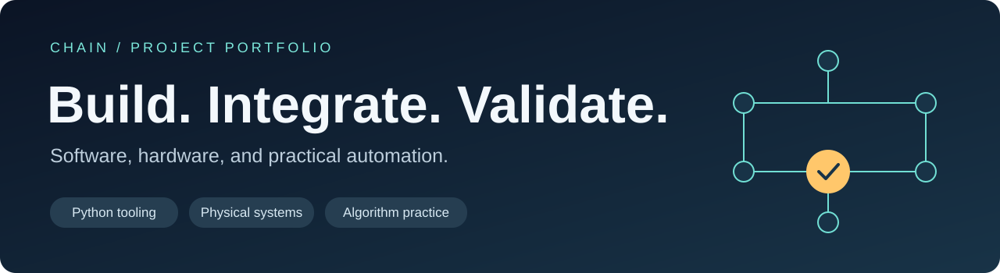

# Hi, I'm Chain

I enjoy turning practical problems into working tools and physical prototypes. My projects span Python automation, an AV operations demo, Android-to-Arduino integration, and algorithm practice.

I bring a hands-on approach: define the behavior, connect the pieces, test what actually happens, and improve the result. I use AI-assisted development and describe my role and implementation provenance in project documentation.

## Selected work

| Project | What it demonstrates | Explore |
| --- | --- | --- |
| **Haptic Navigation** | Original concept; hands-on circuit/assembly work; acceptance and refinement of an AI-generated Android app; final prototype testing and technical presentation | [Technical case study](projects/haptic-navigation.md) |
| **AV Operations Portal** | Python/Streamlit sample with CSV inventory, manager/technician roles, JSON command simulation, and audit logging | [Repository](https://github.com/chain567/nyu-av-sample-app) |
| **Visio Batch Image Export** | Python desktop utility using Windows COM automation to export document trees while preserving folder structure | [Repository](https://github.com/chain567/visio-batch-image) |
| **Algorithm Notes** | Python solutions and explanations covering arrays, strings, linked lists, trees, graphs, and dynamic programming | [Solutions & notes](https://github.com/chain567/leetcode-notes) |

## Technical interests and project experience

| Area | Tools and concepts in my projects |
| --- | --- |
| Automation & data | Python, CSV workflows, Pandas, Windows COM, batch processing |
| Applications & integration | Streamlit, JSON payloads, role-based demo workflows; Kotlin/Jetpack Compose and Google Maps integration through an AI-assisted prototype |
| Hardware & validation | Arduino, Bluetooth-connected prototyping, circuit assembly, soldering, acceptance testing |
| Ongoing learning | Data structures and algorithms, Java, MySQL, web APIs |

I also enjoy small-form-factor PC builds and hands-on hardware troubleshooting.

**Start with the [haptic case study](projects/haptic-navigation.md)** for my contribution across concept, software acceptance, physical integration, and testing, or browse the tools above for concrete implementation examples.

Contribution activity

<picture>
  <source media="(prefers-color-scheme: dark)" srcset="https://raw.githubusercontent.com/chain567/chain567/output/github-contribution-grid-snake-dark.svg">
  
</picture>

