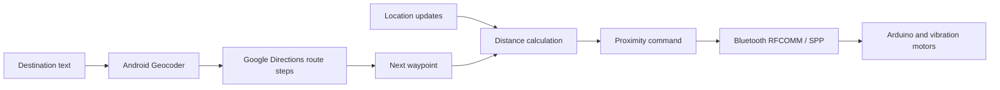

[← Back to profile](../README.md)

# Haptic Navigation

**A physical computing prototype connecting Android navigation to Arduino-based vibration feedback.**

Kotlin / Jetpack Compose · Google Maps · Android location services · Bluetooth Classic SPP · Arduino

## Project idea

I originated the idea of supplementing on-screen navigation with a connected haptic device. The Android app searches for a destination, retrieves route steps, tracks location, and sends proximity commands to an Arduino-based prototype with inexpensive coin-style vibration motors.

The technical goal was to connect a real-world input—location—to a physical output. The diagram is an illustration of the inspected system, not a photograph or screenshot. The Android source repository is currently private.

## My role

| Area | My contribution |
| --- | --- |
| Concept | Originated the project idea and intended behavior |
| Software acceptance | Evaluated Gemini-generated code, guided adjustments, and directed optimization against the intended behavior |
| Hardware | Participated hands-on throughout circuit work and assembly; performed approximately half the soldering |
| Validation | Was responsible for final prototype testing |
| Communication | Delivered the main technical explanation in the final presentation |

Gemini generated the software implementation. I present this as experience in concept development, AI-assisted implementation oversight, hardware integration, and validation. I do not claim independent authorship of the Kotlin application. The portfolio write-up and diagrams were prepared with Codex assistance.

## System architecture

The Android screen shows the map, route polyline, current location, destination, and turn instructions. A requested high-accuracy location interval of 1,000 ms feeds the distance calculation; this is a configuration value, not measured performance.

## The software-to-hardware contract

The app writes one of three ASCII command bytes with no newline. It remembers the previous command and suppresses consecutive duplicates.

| Distance to the next waypoint | Behavior in the inspected app |
| --- | --- |
| Above 100 m | `0` — stop cue |
| Above 50 m through 100 m | `1` — first proximity band |
| 10 m through 50 m | `2` — closer proximity band |
| Below 10 m at an intermediate waypoint | Advance to the next route step |
| Below 10 m at the final waypoint | Request `2` and disconnect |

The codes represent proximity, not left/right instructions. The controller's exact vibration patterns and firmware are not included in the Android repository. Arduino board and Bluetooth module models are not documented.

## Engineering observations

- **Distance has a meaning:** the implementation measures straight-line distance to the next route-step endpoint, not remaining distance along the route. GPS noise can change the threshold decision.
- **A write request is not a receipt:** there is no acknowledgement protocol. The final asynchronous write can race with socket closure, so the actual arrival cue needs hardware verification.
- **Lifecycle affects physical behavior:** location updates stop on pause, while pausing does not explicitly send a stop command to the receiver.
- **Local configuration has limits:** keeping a key outside Git prevents source disclosure; a key packaged in an Android app remains extractable. Broader deployment needs an appropriate SDK or protected web-service architecture.

These are observations from reviewing the source, not claims that production hardening has already been completed.

## Testing and scope

I was responsible for final testing of the original physical prototype. No logs, device list, measured latency/accuracy, user study, or demo media are supplied with this case study, so I do not claim quantitative performance results. The current portfolio review inspected source and configuration; it did not rerun an Android build or physical test.

The prototype does not implement off-route rerouting, explicit walking-mode selection, left/right haptic encoding, or background navigation. The next useful test session would capture actual receiver commands across threshold transitions, arrival, Bluetooth loss, and pause/resume.

## What this project contributes to my portfolio

The strongest evidence is the responsibility I carried across the prototype: originating the idea, evaluating software behavior, doing hands-on hardware work, running final tests, and explaining the technical system. Together with my [Python automation utility](https://github.com/chain567/visio-batch-image), [AV operations demo](https://github.com/chain567/nyu-av-sample-app), and [algorithm notes](https://github.com/chain567/leetcode-notes), it shows a broad practical interest in software, hardware, and integration.
