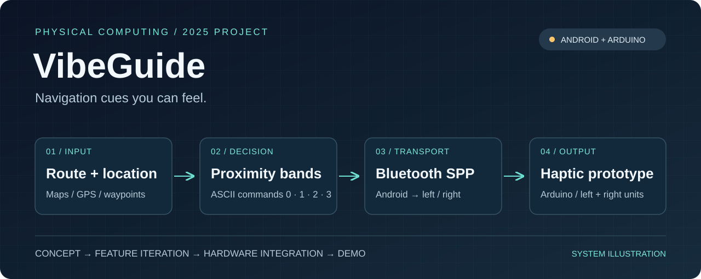
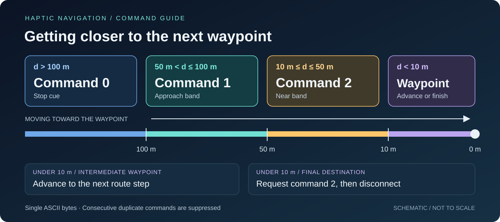
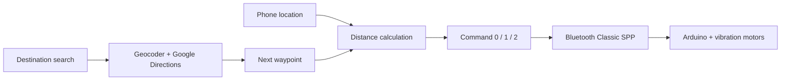

[← Back to profile](../README.md)

# Haptic Navigation

**Built in 2025 · Portfolio write-up updated in 2026**

Kotlin · Jetpack Compose · Google Maps · Bluetooth Classic SPP · Arduino

## The idea

I came up with the idea of supplementing on-screen navigation with vibration cues from a connected device. The Android app searches for a destination, retrieves route steps, follows the phone's location, and sends proximity commands to an Arduino-based prototype with coin-style vibration motors.

I completed the original project in 2025 and am now organizing it for my portfolio. The Android source is currently in a private repository.

## My role

I defined the intended behavior and used Gemini to generate the software. I evaluated the results and guided adjustments and optimization. Alongside the software work, I participated hands-on throughout circuit assembly, completed approximately half the soldering, and delivered the main technical explanation in our presentation.

I was responsible for the final functional test. We did a simple test with the connected prototype and confirmed that the basic navigation-to-vibration workflow worked. Testing was limited to basic functionality.

## How distance becomes a command

The app measures straight-line distance to the next route waypoint:

| Distance | Behavior |
| --- | --- |
| More than 100 m | `0` — stop cue |
| More than 50 m, up to 100 m | `1` — approach band |
| 10 m through 50 m | `2` — near band |
| Below 10 m, intermediate waypoint | Advance to the next route step |
| Below 10 m, final waypoint | Request `2` and disconnect |

The receiver interprets these single-byte ASCII commands as vibration cues. The app sends a command when it changes; the current scheme represents proximity rather than left/right instructions.

## System architecture

The Android interface displays the route, location, destination, and turn instructions. The connection uses Bluetooth Classic RFCOMM, while location updates are requested at a 1-second interval.

## What I took from the project

This project connected an idea, generated software, physical assembly, and a working demonstration. My contribution was defining the behavior, evaluating and refining the software, doing hands-on hardware work, checking the connected prototype, and explaining the technical system.

For a future version, I'd focus on reliable arrival/stop commands, Bluetooth recovery, and smoother waypoint handling under GPS noise. The current version is a functional prototype.

My other projects include a [Visio automation utility](https://github.com/chain567/visio-batch-image), an [AV operations demo](https://github.com/chain567/nyu-av-sample-app), and [algorithm notes](https://github.com/chain567/leetcode-notes).
